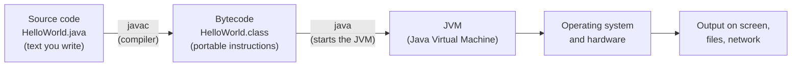
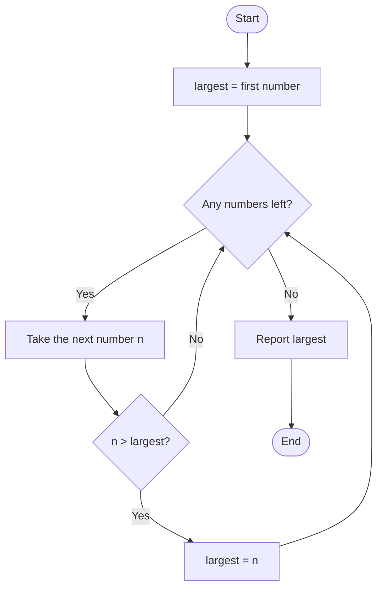
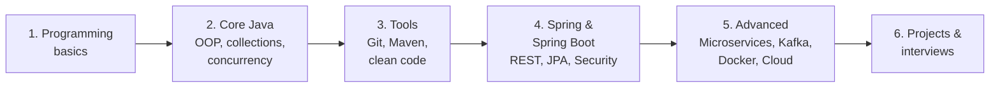

# Part I — Programming and Computer Science Foundations {.unnumbered}

This part assumes nothing. By the end of it you will have a working Java environment and will be able to write, run and reason about small Java programs: variables, decisions, loops, arrays, strings, methods and recursion.

## Chapter 1: Introduction to Programming

**Learning objectives.** After this chapter you will be able to:

- explain what a program is and how a computer executes it;
- distinguish source code, compilation, interpretation and runtime;
- describe a solution as an algorithm, in pseudocode, and as a flowchart;
- explain where Java fits among programming languages and what a Java backend developer does;
- install JDK 21 and an IDE, and compile and run your first Java programs from both the command line and the IDE.

**Prerequisites.** None. You need a computer and a willingness to type the examples.

### 1.1 What Is Programming?

A computer is extremely fast and extremely literal. It will do exactly what you tell it, billions of times per second, and it will not guess what you meant. **Programming** is the activity of writing precise instructions, called a **program**, that tell a computer how to solve a problem.

A *problem* might be small ("add two numbers"), everyday ("show my bank balance"), or enormous ("route millions of food orders to the nearest restaurant"). In every case the work has the same shape:

1. Understand the problem exactly.
2. Break it into small, unambiguous steps.
3. Write those steps in a language the computer can run.
4. Run them, find where reality differs from your intention, and fix it.

Step 4 is not a failure of programming; it *is* programming. Professional developers spend a large share of their time reading code and finding out why it does not do what they expected. This book teaches you to do that systematically.

::: analogy
A program is like a **recipe**. A recipe lists ingredients (data) and steps (instructions) in a fixed order. A cook who follows it produces a dish. Where the analogy stops: a human cook can cope with "add salt to taste". A computer cannot. Every instruction must be exact, and the "cook" never improvises.
:::

### 1.2 How a Computer Runs Your Program

At the lowest level, a computer has three parts that matter to us:

- The **CPU** (central processing unit) carries out very simple operations: add two numbers, compare two numbers, copy a value, jump to a different instruction.
- **Memory (RAM)** holds the program and the data it is working on, while it runs.
- **Storage** (SSD or disk) keeps files permanently, including your program, when it is not running.

The CPU understands only **machine code**: sequences of binary numbers, each one an instruction such as "add these two registers". Writing machine code by hand is slow and error-prone, and it differs between CPU families (an Intel/AMD x86-64 laptop and an Apple or ARM phone use different instruction sets).

So people invented **high-level languages** such as Java, Python and C. You write readable text, called **source code**, and a tool translates it into something the machine can run. There are two classic ways to translate:

| Approach | What happens | Examples | Trade-off |
|---|---|---|---|
| **Compilation** | A **compiler** translates the whole program ahead of time into a separate file the machine can run. | C, C++, Go, Rust | Fast at run time; you must recompile for each platform. |
| **Interpretation** | An **interpreter** reads the source and carries out each instruction while the program runs. | Classic Python, shell scripts | Easy to run anywhere; usually slower. |

Java uses a clever mixture of both, which is the topic of Chapter 2. For now, remember this pipeline:



*Explanation.* You write `.java` files. The Java **compiler** (`javac`) checks them for mistakes and translates them into **bytecode** stored in `.class` files. Bytecode is not tied to one CPU. The **JVM** (Java Virtual Machine), started by the `java` command, loads the bytecode and runs it on whatever machine you are using. This is why the same `.class` file can run on Windows, macOS and Linux. We take the JVM apart in Chapter 2.

#### Compile time versus run time

Two phrases will appear constantly:

- **Compile time**: the moment `javac` examines your code. Errors found here are *compile-time errors*, such as a missing semicolon or a type mismatch. The program never starts.
- **Run time**: the moment the program is actually executing. Errors here are *runtime errors* (exceptions), such as dividing by zero or opening a file that does not exist.

There is a third category that no tool reports: **logic errors**. The program compiles, runs without crashing, and gives the wrong answer. These are the hardest to find, and they are why we test (Chapter 34).

### 1.3 Algorithms, Pseudocode and Flowcharts

An **algorithm** is a finite, ordered list of unambiguous steps that solves a problem. "Make tea" is an algorithm; "make good tea" is not, because "good" is not precise.

Before writing any code, experienced developers think in terms of algorithms. Two tools help you do this without worrying about language syntax.

**Pseudocode** is structured plain English. There is no official grammar; its only rule is that every step must be precise enough that a person could follow it without guessing. Here is an algorithm to find the largest number in a list:

```text
PSEUDOCODE: find the largest number in a list
1. Let largest be the first number in the list.
2. For each remaining number in the list:
     a. If the number is greater than largest, set largest to that number.
3. The answer is largest.
```

A **flowchart** draws the same algorithm as a diagram of steps and decisions:



*Explanation.* Rounded boxes mark the start and end. Rectangles are actions. Diamonds are yes/no questions. The arrow from "largest = n" back to "Any numbers left?" is a **loop**: the algorithm repeats until the list is exhausted. Notice that the flowchart contains the three building blocks of every program ever written: **sequence** (do steps in order), **selection** (choose based on a condition), and **iteration** (repeat).

Now the same algorithm in Java. Do not worry about understanding every word yet; the comments map each line to the pseudocode. Chapters 3 to 6 explain everything used here.

{{code:ch01/largest/LargestNumber.java}}

*Line-by-line.*

- `static int findLargest(int[] numbers)` declares a **method** (a named, reusable block of code) that takes an array of integers and returns one integer.
- `int largest = numbers[0];` is step 1 of the pseudocode: start with the first number. Array positions start at 0.
- The `for` loop visits positions 1, 2, 3, … up to the end. This is the "for each remaining number" step.
- The `if` is the decision diamond. `>` means "greater than".
- `return largest;` hands the answer back to whoever called the method.
- `main` is where Java starts running a program. It builds an array called `marks`, prints it, and prints the result of `findLargest(marks)`.

*Execution flow.* `main` runs first. It calls `findLargest`, passing the five marks. Inside, `largest` begins as 42, then becomes 77 (77 > 42), stays 77 when 15 is checked, becomes 98, and stays 98 when 63 is checked. The method returns 98 to `main`, which prints it.

{{out:ch01/largest/LargestNumber}}

::: best
**Think first, code second.** When a problem is new, write the pseudocode on paper before typing Java. Most beginner "coding" difficulty is really "thinking" difficulty, and it is much cheaper to fix a wrong plan than wrong code.
:::

### 1.4 Where Java Fits

Java was created at Sun Microsystems in the early 1990s, first released in 1995, and is now stewarded by Oracle together with the open-source **OpenJDK** project and a large community. Its original promise was **"write once, run anywhere"**: compile once to bytecode, run on any machine with a JVM. Three decades later it is still one of the most widely used languages in professional software, especially for server-side systems.

Java's main characteristics:

- **Statically typed.** Every variable has a declared type that the compiler checks. This catches whole classes of mistakes before the program runs.
- **Object-oriented.** Programs are organised as objects that combine data and behaviour (Chapter 7).
- **Automatic memory management.** A **garbage collector** frees memory you no longer use, so you do not manually release it as in C or C++ (Chapter 16).
- **Platform independent.** Bytecode runs on the JVM on any supported operating system.
- **A vast ecosystem.** Libraries and frameworks (Spring, Hibernate, Kafka clients and thousands more) mean you rarely build common pieces from scratch.
- **Strong backward compatibility.** Code written years ago usually still compiles and runs, which is why large organisations trust it.

Typical uses: web back ends and REST APIs, banking and payment systems, large enterprise software, Android applications (historically; Kotlin is now also common), big-data tools, and high-throughput messaging systems.

#### Java versions and long-term support

Java releases a new version every six months. Most are short-lived. Every few years a version is designated **LTS (Long-Term Support)**, which means vendors maintain it for years. Companies deploy LTS versions. The current LTS line is **8, 11, 17, 21 and 25**. This book teaches on **Java 21** and explains what changed in **Java 25** where it matters.

::: warning
Older tutorials often use Java 8 or Java 11. That code still works, but newer features (records, text blocks, switch expressions, pattern matching, virtual threads) make modern Java shorter and safer. Chapter 14 shows the differences side by side.
:::

### 1.5 What Does a Java Backend Developer Do?

A **backend** developer builds the part of an application that users do not see: the server that stores data, enforces rules and answers requests from web pages and mobile apps.

Imagine ordering food on a phone. The app (front end) shows menus. When you tap "Place order" it sends a request over the internet to a back-end service. That service checks that you are logged in, validates the order, charges the payment, saves the order in a database, tells the restaurant, and replies "Order confirmed". Everything after the tap is back-end work.

Day to day, a Java backend developer typically:

- designs and builds **REST APIs** that other systems call;
- models business rules in code and stores data in **databases**;
- secures APIs with authentication and authorisation;
- writes **automated tests** and reviews teammates' code;
- packages and deploys services with **Docker** and CI/CD pipelines;
- monitors services in production and investigates problems.

The road from zero to job-ready follows the structure of this book:



*Explanation.* Each stage depends on the previous one. Learners who jump straight to Spring Boot without core Java usually hit a wall: framework error messages assume you understand objects, interfaces, generics and exceptions. Chapter 52 turns this roadmap into a weekly study plan.

### 1.6 Setting Up Your Development Environment

You need three things: a **JDK**, an **editor or IDE**, and a **terminal**.

#### Step 1: Install the JDK

The **JDK (Java Development Kit)** contains the compiler (`javac`), the runtime (`java`) and standard tools. Several organisations build free, production-quality OpenJDK distributions. This book was tested with **Eclipse Temurin 21**, available from adoptium.net. Other vendors' builds of Java 21 behave the same for everything in this book.

- **Windows:** download the Temurin 21 installer (`.msi`). In the installer, enable the options to *set `JAVA_HOME`* and *add to PATH*.
- **macOS:** download the `.pkg` installer, or use Homebrew's Temurin cask.
- **Linux:** install your distribution's `openjdk-21-jdk` package, or use Temurin's package repository.

#### Step 2: Verify the installation

Open a new terminal (PowerShell, Command Prompt, Terminal or a shell) and run:

```text
java -version
javac -version
```

On the machine used to write this book, `java -version` printed:

```text
openjdk version "21.0.12.1" 2026-08-18 LTS
OpenJDK Runtime Environment Temurin-21.0.12.1+1 (build 21.0.12.1+1-LTS)
OpenJDK 64-Bit Server VM Temurin-21.0.12.1+1 (build 21.0.12.1+1-LTS, mixed mode, sharing)
```

Your exact numbers will differ if you install a different update, but the major version must be `21`. Both commands must work. If `java` works but `javac` does not, you installed only a **JRE** (runtime) and need the full JDK.

#### Step 3: Install an IDE

An **IDE (Integrated Development Environment)** combines an editor, a compiler, a debugger and project tools. Pick one:

- **IntelliJ IDEA** (JetBrains): the most widely used Java IDE in industry and the one used in this book. JetBrains offers a free edition; check their site for the current editions and licence terms, as these have changed over time.
- **Visual Studio Code** with the *Extension Pack for Java*: a lighter alternative that works well for learning.

::: tip
Learn the command line even though the IDE hides it. When something fails on a build server there is no IDE, only a terminal, and you must know what `javac`, `java` and `mvn` actually do.
:::

#### Step 4: Install Maven (later) and Git

Maven (Chapter 20) and Git (Chapter 19) are needed from Part III onward, and you can install them now: Maven 3.9.x from maven.apache.org, Git from git-scm.com. Verify with `mvn -v` and `git --version`.

### 1.7 Your First Program: Hello, World

Create a folder called `javabook`, and inside it a file named exactly `HelloWorld.java`:

{{code:ch01/hello/HelloWorld.java}}

*Line-by-line.*

- `public class HelloWorld { ... }` declares a **class**, Java's basic unit of code. The class name must match the file name, including capital letters.
- `public static void main(String[] args)` is the **entry point**. The JVM looks for a method with exactly this signature when starting the program. `public` means callable from anywhere; `static` means it belongs to the class itself, not to an object; `void` means it returns nothing; `String[] args` receives command-line arguments.
- `System.out.println("Hello, World!");` prints text followed by a new line. `System.out` is the standard output stream; `println` is a method on it. Every statement ends with a semicolon.
- Curly braces `{ }` group code into blocks.

**Compile and run from the terminal.** In the folder that contains the file:

```text
javac HelloWorld.java
java HelloWorld
```

`javac` produces `HelloWorld.class`. `java HelloWorld` starts the JVM and runs it (note: you give the *class name*, without `.class`).

{{out:ch01/hello/HelloWorld}}

*Execution flow.* (1) `javac` parses the file, checks it, and writes bytecode. (2) `java` starts a JVM. (3) The JVM loads `HelloWorld.class`. (4) It finds `main` and executes its one statement. (5) `main` ends, so the program ends.

**A shortcut.** Since Java 11 you can run a single source file directly, without a separate `javac` step:

```text
java HelloWorld.java
```

The launcher compiles the file in memory and runs it. This is handy for experiments, but real projects always use a build tool.

::: note
Java 21 includes a *preview* feature for shorter first programs without an explicit class. A final version of that idea ("compact source files and instance `main` methods", JEP 512) arrived in Java 25. This book uses the classic form shown above because it works on every Java version and matches the code you will meet in real projects.
:::

**Run it in the IDE.** In IntelliJ IDEA: create a new project (Build system: *IntelliJ* or *Maven*, JDK: 21), add a class named `HelloWorld`, type the code, and click the green triangle beside `main`. The *Run* window shows the same output.

### 1.8 Reading Input: A Slightly Bigger Program

Programs become useful when they respond to data. This program asks for a name and an age:

{{code:ch01/greeter/Greeter.java}}

*Key ideas.*

- `import java.util.Scanner;` makes the `Scanner` class from Java's standard library available. Libraries are how you reuse other people's tested code.
- `new Scanner(System.in)` creates a scanner that reads from the keyboard (**standard input**).
- `nextLine()` reads a whole line as text (`String`); `nextInt()` reads a whole number (`int`).
- `"Hello, " + name + ...` joins text and values. The parentheses in `(age + 1)` force the addition to happen *before* joining; without them, Java would join the digits "20" and "1" as text and print "201".

A session at the terminal looks like this (what you type follows each prompt):

```text
What is your name? Asha
How old are you? 20
Hello, Asha! Next year you will be 21.
```

The final line was produced by the program when it was compiled and run with the input `Asha` and `20`.

{{code:ch01/average/AverageCalculator.java}}

This last example combines everything: a method, a loop, a decision (the empty-array guard), and a **cast** `(double) total` that makes the division produce a decimal result instead of dropping the fraction. Without the cast, `total / scores.length` would divide two integers and discard the remainder. We study casting in Chapter 3.

{{out:ch01/average/AverageCalculator}}

### 1.9 Common Mistakes and How to Read Error Messages

Beginners often panic at red text. Compiler messages are precise and, once you can read them, very helpful. Always read the **first** error first; later errors are often consequences of it.

::: mistake
**Missing semicolon.** The program below forgets the `;` after the `println(...)` call.

```text
Broken.java:3: error: ';' expected
        System.out.println("Hello, World!")
                                           ^
1 error
```

*How to read it.* The message gives the file, the line number (3), what is wrong (`';' expected`), the offending line, and a caret `^` pointing at the spot. *Fix:* add the semicolon.
:::

::: mistake
**Wrong type and a typo.** Putting text in an integer variable and misspelling a method name:

```text
Broken2.java:3: error: incompatible types: String cannot be converted to int
        int count = "five";
                    ^
Broken2.java:4: error: cannot find symbol
        System.out.printn(count);
                  ^
  symbol:   method printn(int)
  location: variable out of type PrintStream
2 errors
```

*Fix:* give `count` a number (`int count = 5;`) and spell the method `println`. "Cannot find symbol" almost always means a typo, a missing `import`, or a name used outside the place where it exists.
:::

::: mistake
**File name does not match the public class.** Saving `public class HelloWorld` in a file called `Hello.java`:

```text
Hello.java:1: error: class HelloWorld is public, should be declared in a file named HelloWorld.java
public class HelloWorld {
       ^
1 error
```

*Fix:* rename the file to `HelloWorld.java`, or rename the class. Java is **case-sensitive**: `HelloWorld`, `helloworld` and `Helloworld` are different names.
:::

::: mistake
**Wrong case when running.** After a successful compile, `java Helloworld` fails with:

```text
Error: Could not find or load main class Helloworld
Caused by: java.lang.NoClassDefFoundError: Helloworld (wrong name: HelloWorld)
```

*Fix:* run `java HelloWorld`. On Windows, file names are not case-sensitive, so the file can be found while the class inside has a different name, which produces this slightly confusing message.
:::

::: mistake
**`'javac' is not recognized` (Windows) or `command not found` (macOS/Linux).** The terminal cannot find the JDK. Either the JDK is not installed, you installed only a JRE, or its `bin` folder is not on the `PATH`. *Fix:* reinstall with "add to PATH" enabled, then **open a new terminal** (old terminals keep the old PATH).
:::

**A debugging mindset.** When something fails: (1) read the exact message, (2) find the line it points to, (3) look at the line *before* it too, since a missing character often shows up on the next line, (4) change one thing at a time, (5) search for the exact error text only after you have tried to understand it yourself.

### 1.10 Best Practices from Day One

::: best
- **Use meaningful names:** `highestMark` tells a reader more than `x`.
- **Format consistently.** Indent by four spaces inside each block. IDEs can reformat code for you (IntelliJ: *Ctrl+Alt+L*).
- **Compile and run often.** Write five lines, run them. Do not write 200 lines and then hunt for the one mistake.
- **Type the examples; do not paste them.** Your fingers and eyes learn syntax that way.
- **Keep every program you write** in a Git repository (Chapter 19). Your history of small projects becomes evidence of your skill.
:::

### 1.11 Exercises

Do these in order. Try before you look anything up.

1. **Hello, you.** Change `HelloWorld` so that it prints your own name on one line and your city on the next line. Compile and run it from the terminal.
2. **Break it on purpose.** Remove the closing brace `}` of `HelloWorld`, then compile. Read the error. Then restore it and introduce two different errors from Section 1.9. Predict each message before compiling.
3. **Pseudocode first.** Write pseudocode, then a flowchart on paper, for an algorithm that decides whether a number is even or odd. (Hint: even numbers leave remainder 0 when divided by 2.) You do not need to code it yet.
4. **Modify the algorithm.** Change `LargestNumber` so that it finds the *smallest* number. Which one line of the logic must change?
5. **Extend the average.** In `AverageCalculator`, add a second method that returns the *highest* score using the approach from `LargestNumber`, and print both. Then explain why `(double) total / scores.length` is not the same as `(double) (total / scores.length)`.
6. **Challenge: trace by hand.** For `findLargest(new int[]{5, 3, 9, 9, 1})`, write a table with the value of `i`, `numbers[i]` and `largest` after each loop iteration. What is the final value, and what does the code do when two numbers tie?

### 1.12 Interview Questions and Answers

::: interview
Chapter 1 topics are rarely asked as "pure theory" in interviews, but interviewers use them to check that your fundamentals are clear. Expect them in the first five minutes of a junior-level screening.
:::

**Q1. What is the difference between a compiler and an interpreter?**
A compiler translates a whole program into another form before it runs; an interpreter executes the source (or an intermediate form) step by step while the program runs. Java does both: `javac` compiles source to bytecode, and the JVM then interprets or just-in-time compiles that bytecode to machine code.

**Q2. What is bytecode, and why does Java use it?**
Bytecode is the instruction set of the Java Virtual Machine, stored in `.class` files. Because it is independent of any physical CPU, one compiled program runs on any platform that has a JVM. This supports Java's "write once, run anywhere" goal.

**Q3. What is the difference between the JDK, the JRE and the JVM?**
The JVM runs bytecode. The JRE is the JVM plus the standard class libraries needed to run programs. The JDK is the JRE plus development tools such as `javac`. Developers install the JDK; modern distributions ship the JDK and no longer emphasise a separate JRE download. (Chapter 2 covers this in depth.)

**Q4. What is the entry point of a Java program?**
The JVM begins execution at `public static void main(String[] args)` in the class you name on the command line. `public` so the JVM can call it from outside, `static` so no object is needed first, and `void` because it returns nothing to the JVM.

**Q5. What is the difference between a compile-time error, a runtime error and a logic error?**
A compile-time error is found by the compiler and stops the program from being built (for example a missing semicolon or a type mismatch). A runtime error occurs while the program runs and typically throws an exception (for example, dividing by zero). A logic error produces a wrong result without any error message and is found only by testing or code review.

**Q6. Why is Java called platform independent, and is that fully true?**
The bytecode is platform independent, but the JVM itself is platform specific: there is a different JVM build for Windows, Linux and macOS. So Java programs are portable; the JVM is not.

**Q7. (Scenario) You run `javac HelloWorld.java` and get "class HelloWorld is public, should be declared in a file named HelloWorld.java". What happened and how do you fix it?**
A public class must live in a file with the same name. The file was probably named differently (for example `Hello.java`). Rename the file or the class so they match, remembering that Java is case-sensitive.

**Q8. (Coding) Write a method that returns the largest number in an `int[]`. What happens on an empty array, and how would you handle it?**
The method in Section 1.3 starts with `numbers[0]`, so an empty array throws `ArrayIndexOutOfBoundsException`. A robust version validates the input first, either by throwing an `IllegalArgumentException("array must not be empty")` or by returning an `OptionalInt`. Time complexity is O(n) because each element is visited once; extra space is O(1).

**Follow-up:** *How would the code change if the values were `Integer` objects, or if a stream were used?* (We answer this in Chapters 11 and 13.)

### 1.13 Chapter Summary

- A **program** is an exact list of instructions; **programming** is writing them, running them and fixing the differences between what you meant and what happened.
- Source code is translated for the machine by **compilation** and/or **interpretation**. Java compiles to **bytecode**, which the **JVM** runs.
- An **algorithm** is a finite, precise sequence of steps. Pseudocode and flowcharts let you design algorithms before coding. All algorithms combine sequence, selection and iteration.
- Java is statically typed, object-oriented, garbage-collected and platform independent, with LTS releases 8, 11, 17, 21 and 25. This book uses **Java 21**.
- A backend developer builds servers, APIs, databases, security and deployment pipelines.
- You installed a JDK and an IDE, and you ran programs from both the command line and the IDE.
- Read compiler errors from the first one, understand their structure (file, line, message, caret), and compile often.

### 1.14 Key Terms and Revision Notes

| Term | Meaning |
|---|---|
| Algorithm | A finite, ordered, unambiguous list of steps that solves a problem |
| Pseudocode | Informal, structured description of an algorithm |
| Source code | The human-readable program text (`.java`) |
| Compiler (`javac`) | Translates source into bytecode |
| Bytecode | Portable instructions in `.class` files |
| JVM | The virtual machine that loads and runs bytecode |
| JDK / JRE | Development kit (with tools) / runtime environment |
| LTS | Long-Term Support release (8, 11, 17, 21, 25) |
| Compile-time error | Detected by the compiler; the program does not build |
| Runtime error | Occurs while running; usually an exception |
| Logic error | Program runs but gives wrong results |
| Entry point | `public static void main(String[] args)` |
| IDE | Integrated Development Environment (IntelliJ IDEA, VS Code) |

**Quick revision checklist.**

- [ ] I can explain source → bytecode → JVM in my own words.
- [ ] I can write a simple algorithm as pseudocode and a flowchart.
- [ ] `java -version` and `javac -version` both show 21 on my machine.
- [ ] I compiled and ran `HelloWorld` from the terminal and from the IDE.
- [ ] I can read a `javac` error message and name the file, line and problem.

**Where we go next.** Chapter 2 opens the JVM: how class files are loaded, how memory is organised, and why Java is fast even though it runs "interpreted" bytecode.

**References for this chapter.** Oracle, *The Java Language Specification, Java SE 21 Edition*; OpenJDK project documentation (openjdk.org), including JEP 330 (launch single-file source-code programs) and JEP 512 (compact source files and instance main methods); Eclipse Adoptium (adoptium.net) for Temurin builds; the Java SE release roadmap (oracle.com/java/technologies/java-se-support-roadmap.html) for LTS status.
