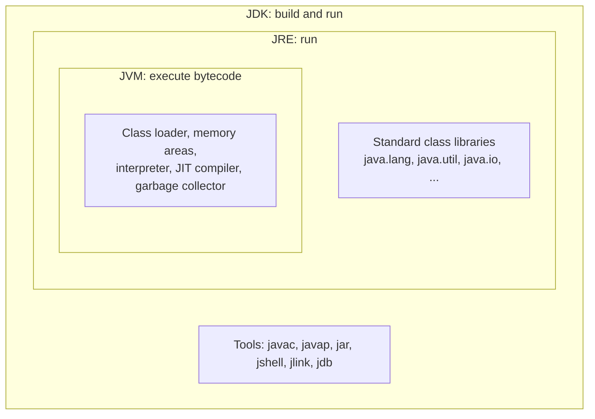
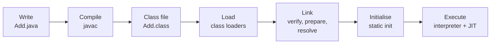
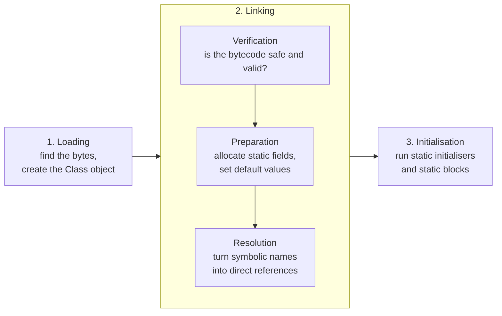
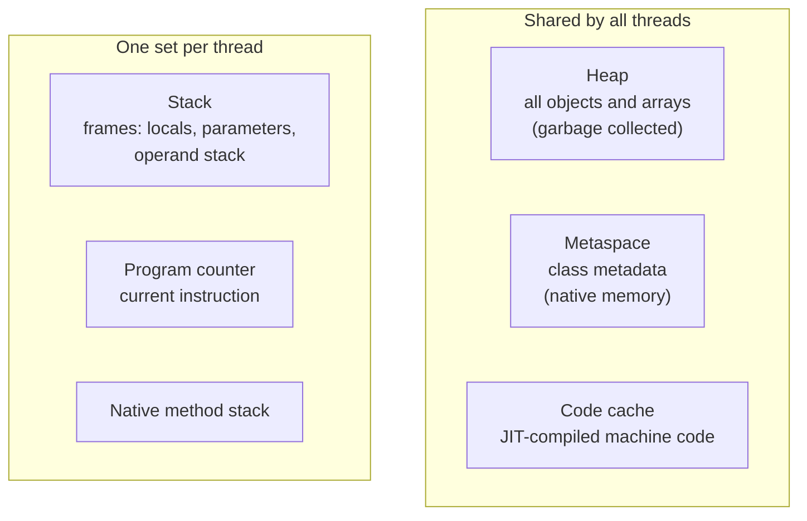

## Chapter 2: Java Architecture

**Learning objectives.** After this chapter you will be able to:

- distinguish the Java language, the JDK, the JRE and the JVM;
- read simple bytecode with `javap` and explain what a class file contains;
- describe the compile, load, link, initialise and execute lifecycle;
- explain the roles of the interpreter and the JIT compiler;
- name the JVM's main memory areas and say what lives in each;
- explain what "platform independent" really means, and how Java versions and LTS releases work.

**Prerequisites.** Chapter 1 (you can compile and run a Java program).

### 2.1 Four Names That Get Confused

Beginners hear "Java", "JDK", "JRE" and "JVM" used almost interchangeably. They are four different things.

- **The Java language** is the set of rules for writing programs: keywords, syntax, types. It is defined by the *Java Language Specification*.
- **The JVM (Java Virtual Machine)** is a program that loads and runs bytecode. Its behaviour is defined by the *Java Virtual Machine Specification*. Many implementations exist; the one in OpenJDK and in Temurin is called **HotSpot**.
- **The JRE (Java Runtime Environment)** is the JVM plus the standard class libraries (`String`, `ArrayList`, `Files`, …) needed to *run* programs.
- **The JDK (Java Development Kit)** is the JRE plus the tools needed to *build* programs: `javac`, `javap`, `jar`, `jshell`, `jlink` and more.

*Explanation.* Each box contains the one inside it. When you only need to run a finished application, the runtime pieces are enough. When you write code, you need the JDK.

| Term | Contains | Used by | Key command |
|---|---|---|---|
| JVM | Loader, memory, execution engine, GC | The runtime | `java` starts one |
| JRE | JVM + class libraries | People who only run programs | `java` |
| JDK | JRE + development tools | Developers | `javac`, `javap`, `jar` |

::: note
Since Java 9, the platform is **modular**, and since Java 11 most vendors no longer publish a separate JRE download. Today you install a JDK for development. For deployment, you can use the `jlink` tool to create a small custom runtime that contains only the modules your application needs. In day-to-day work, "install Java" means "install a JDK".
:::

### 2.2 The Lifecycle of a Java Program

Everything that happens between "I typed code" and "output appears" is a pipeline:

The left half (write, compile) happens on the developer's machine, once. The right half (load, link, initialise, execute) happens inside the JVM every time the program runs. We take the stages in order.

### 2.3 Bytecode and Class Files

The compiler does not produce machine code for a particular processor. It produces **bytecode**, instructions for an imaginary processor, the JVM. The bytecode for each class is stored in a **class file** (`.class`).

A class file is a binary file that always starts with the same four bytes (`CA FE BA BE`, a famous in-joke) and then records the class's name, its parent class, the **constant pool** (a table of names and literals), its fields, and the bytecode of each method. It also stores a **major version number** that says which Java version compiled it: 52 means Java 8, 55 means Java 11, 61 means Java 17, 65 means Java 21 and 69 means Java 25. A JVM refuses to load a class file whose major version is newer than it understands. That is the cause of the common error `UnsupportedClassVersionError` when you run a Java 21 build on a Java 17 runtime.

You can look inside with the JDK's disassembler, `javap`. Here is a tiny class:

{{code:ch02/bytecode/Add.java}}

Compile it and disassemble it with `javac Add.java` and `javap -c -p Add.class` (`-c` shows bytecode, `-p` includes private members):

{{out:ch02/bytecode/javap}}

*Reading it.* The JVM is a **stack machine**: instructions push values onto an **operand stack** and pop them off to compute. For `add(int a, int b)`:

1. `iload_0` pushes local variable 0 (`a`) onto the operand stack; `iload_1` pushes `b`.
2. `iadd` pops two integers, adds them and pushes the result.
3. `istore_2` pops the result into local variable 2 (`sum`).
4. `iload_2` pushes `sum` again and `ireturn` returns the value on top of the stack.

The prefix letter tells you the type: `i` means `int`. In `main`, `iconst_2` and `iconst_3` push the constants 2 and 3, `invokestatic` calls `add`, and `invokevirtual` calls `println`. The string concatenation became an `invokedynamic` instruction: a modern compiler technique (used since Java 9) that lets the JVM choose the most efficient way to build the text. The constructor `Add()` was written by the compiler: if you declare no constructor, it adds a default one that calls `Object`'s constructor.

::: tip
You will rarely read bytecode in daily work, but `javap -c` is a superb way to settle arguments about what the compiler really does. For example, it shows whether a `+` in a loop creates new strings (Chapter 5) or what a `switch` compiles into.
:::

### 2.4 Class Loading, Linking and Initialisation

The JVM does not load every class at start-up. It loads each class **on demand**, the first time the program needs it. For each class, the JVM performs three phases.

*Explanation.*

- **Loading.** A **class loader** reads the class file and creates an in-memory representation of the class.
- **Verification** checks that the bytecode obeys the JVM's rules (correct types on the stack, valid jumps). This is a security feature: it stops damaged or malicious class files from corrupting the JVM.
- **Preparation** reserves memory for `static` fields and gives them default values (`0`, `false`, `null`).
- **Resolution** replaces symbolic references ("the method `add` in class `Add`") with direct references. This is often done lazily, the first time the reference is used.
- **Initialisation** runs the class's `static { ... }` blocks and static field initialisers, in the order they appear in the source. A class is initialised the first time it is actively used: when an instance is created, a static method is called, or a non-constant static field is read or written.

#### Class loaders

A **class loader** is the object that finds class files. HotSpot uses three built-in loaders arranged as a chain:

| Loader | Name | Loads |
|---|---|---|
| Bootstrap | (shown as `null`) | The core of the platform, such as `java.lang.String` |
| Platform | `platform` | Other platform modules |
| Application | `app` | Your classes and the libraries on your class path |

A loader asks its **parent** first, and only loads the class itself if the parent cannot. This **parent delegation** rule guarantees that nobody can replace `java.lang.String` with a fake version just by putting a class of that name on the class path.

The next program shows laziness and loaders in action.

{{code:ch02/classloading/ClassLoadingDemo.java}}

{{out:ch02/classloading/ClassLoadingDemo}}

*What to notice.*

- `ClassLoadingDemo` is initialised first, before `main` runs, so its static block prints first.
- The nested `Engine` class is **not** initialised when `main` starts, nor when the line "Before first use of Engine" prints. Its static block runs only when `Engine.start()` is called for the first time, and runs **once**: the second call prints no initialisation message.
- `String.class.getClassLoader()` prints `null`: the bootstrap loader is represented as `null`. Our own class was loaded by `app`, whose parent is `platform`.

::: interview
"When does a class get loaded and initialised?" is a classic question. Strong answers mention laziness, the three phases, the loader hierarchy with parent delegation, and that static initialisation runs exactly once per loader. Frameworks such as Spring depend on this knowledge when they scan and load classes by name.
:::

### 2.5 Executing Bytecode: Interpreter and JIT Compiler

Once a class is ready, the JVM's **execution engine** runs its bytecode. It has two ways to do so.

- The **interpreter** reads bytecode instructions one by one and performs each. It starts instantly but is slow per instruction.
- The **JIT (Just-In-Time) compiler** translates bytecode into real machine code for the current CPU while the program is running, and then the CPU runs that machine code directly at full speed.

HotSpot combines both in a design called **tiered compilation**:

1. A method starts out **interpreted**, and the JVM counts how often it is called and how often its loops repeat.
2. When a method becomes **hot** (used a lot), the JVM compiles it with a fast, lightly optimising compiler (**C1**) and then, if it stays hot, with a slower, aggressively optimising compiler (**C2**) that uses what it learned about how the program actually behaves (for example, which branch is always taken, or which concrete class a call always reaches).
3. If an assumption later turns out to be wrong, the JVM can **deoptimise** the code: throw away the machine code and fall back to the interpreter.

This is why a Java program often starts slowly and then speeds up: the **warm-up** period. It is also why a quick benchmark that runs a loop once tells you almost nothing about real performance (Chapter 36 returns to this).

::: analogy
Think of a new employee following a written procedure line by line (the interpreter). After doing the same task hundreds of times, the employee memorises it and does it quickly without the manual (compiled code). If the process changes, they go back to the manual (deoptimisation). The analogy stops at one point: the JVM can compile and optimise while the program keeps running and uses live statistics, which a person cannot.
:::

### 2.6 JVM Memory: A First Tour

The JVM organises memory into **runtime data areas**. This is the vocabulary you need for the rest of the book.

- **Heap.** Every object (`new Counter()`) and every array lives on the heap. It is shared by all threads and managed by the **garbage collector**, which reclaims objects that nothing can reach any more. The heap is usually the largest area; its maximum size is set with `-Xmx` (for example `-Xmx512m`). If no flag is given, the JVM picks a default based on the machine's memory, typically a quarter of physical RAM.
- **Stack.** Each thread has its own stack. Every method call pushes a **stack frame** holding that call's local variables, parameters and operand stack, and the frame is removed when the method returns. Stacks are small and fast. Their size is set with `-Xss`. Too many nested calls (usually infinite recursion) causes `StackOverflowError`.
- **Metaspace.** Stores class metadata: method and field descriptions, the constant pool, and so on. It lives in native (non-heap) memory and grows as classes load. (In Java 7 and earlier this was called PermGen, a fixed-size area that caused many out-of-memory errors; Metaspace replaced it in Java 8.)
- **Code cache.** Holds machine code produced by the JIT.
- **Program counter** and **native method stack** track the current instruction and calls into non-Java (native) code.

The practical difference between stack and heap is shown by this program. A method receives a copy of a primitive value but a copy of a *reference* to an object:

{{code:ch02/memory/StackAndHeap.java}}

{{out:ch02/memory/StackAndHeap}}

*Execution flow.* `main` creates `number` (a primitive, stored in `main`'s stack frame) and a `Counter` object (stored on the heap; `main` holds only a reference to it). When `increment` runs it gets its own frame. `number++` changes `increment`'s own copy, so `main`'s `number` stays 10. `counter.value++` follows the reference to the *same* heap object, so the change is visible afterwards: 1. This is the heart of Java's **pass-by-value** behaviour, which Chapter 6 explains fully.

The last part provokes a `StackOverflowError` by recursing without end. Each call adds a frame until the thread's stack is exhausted. The program catches the error only to demonstrate it. In real code you fix the recursion rather than catching the error. We print whether more than 1,000 frames were created instead of the exact depth, because the exact number depends on the machine and JVM settings.

::: warning
The words **stack** and **heap** here are *memory areas*, not the data structures you will meet in Chapters 11 and 51 (a "stack" is also a last-in-first-out collection). The names are shared on purpose: a method call stack really does behave last-in-first-out. Do not confuse the two meanings.
:::

Chapter 16 returns to memory in depth: object layout, generations, garbage collectors, heap dumps and tuning.

### 2.7 Platform Independence: What It Really Means

"Write once, run anywhere" is true for **bytecode**: the same `Add.class` runs on Windows, Linux and macOS. The JVM, however, is **platform specific**: Oracle, Eclipse and others publish a different JVM build for each operating system and CPU family. The JVM acts as a translator between portable bytecode and the local machine.

A few limits to the promise:

- Native libraries (`.dll`, `.so`) and calls into the operating system are platform dependent.
- File paths, line endings and default character sets differ between systems, so careless code can behave differently across them.
- Behaviour that depends on thread scheduling or timing can vary.

Another consequence of this design is that the JVM is not only for Java. Other languages, including **Kotlin**, **Scala** and **Groovy**, compile to the same bytecode and run on the same JVM, and they can call Java libraries such as Spring.

### 2.8 Java Versions, Releases and LTS

Since 2017, a new Java version has been released every six months (March and September). Most releases are supported only until the next one. Certain releases are designated **LTS (Long-Term Support)**: **8, 11, 17, 21 and 25**. Organisations normally run LTS versions in production because vendors provide fixes for many years.

Features arrive through **JEPs** (JDK Enhancement Proposals). A new feature may first appear as a **preview** feature, which you must explicitly enable with `--enable-preview`, so that the community can try it before the design is finalised. Do not use preview features in production code.

This is how this book treats versions:

| Version | Status in this book | What to know |
|---|---|---|
| Java 8 | Legacy reference | Lambdas and streams (Chapter 13). Still found in older systems. |
| Java 11 | Legacy reference | `var` in lambdas, HTTP client, single-file launch |
| Java 17 | Baseline | Records, sealed classes, text blocks, switch expressions |
| **Java 21** | **Primary** | Pattern matching, record patterns, virtual threads |
| Java 25 | Upgrade reference | Latest LTS; differences noted in Chapter 14 |

You can confirm which Java version a program is running on with a few lines:

{{code:ch02/version/ShowVersion.java}}

{{out:ch02/version/ShowVersion}}

(The vendor line shows the JDK build used to produce this book; yours may show a different vendor.)

### 2.9 Common Mistakes

::: mistake
**`UnsupportedClassVersionError`.** You compile with Java 21 but run with an older runtime (for example Java 17):
`... has been compiled by a more recent version of the Java Runtime (class file version 65.0), this version of the Java Runtime only recognizes class file versions up to 61.0`.
*Cause:* the class file's major version (65) is newer than the runtime understands (61). *Fix:* run with Java 21 or newer, or compile for the older target (`javac --release 17`). Check with `java -version` and `javac -version`, which can report different versions if several JDKs are installed.
:::

::: mistake
**Two JDKs, wrong one on the PATH.** `javac -version` prints 21 but `java -version` prints 17 (or the reverse). *Cause:* the PATH finds a different installation for each command. *Fix:* set `JAVA_HOME` to the JDK you want, put `%JAVA_HOME%\bin` (Windows) or `$JAVA_HOME/bin` (macOS/Linux) first on the PATH, and open a new terminal.
:::

::: mistake
**Assuming static initialisation happens at start-up.** A static block that is expected to run "when the program starts" never runs because the class is never used. *Fix:* remember that initialisation is lazy and triggered by first active use. Do not rely on a class being initialised unless your code uses it.
:::

### 2.10 Best Practices

::: best
- **Develop and run on the same major version** that you deploy. Surprises hide in version differences.
- **Prefer LTS releases** for production, and plan upgrades between LTS releases rather than staying on one for a decade.
- **Use `--release N` when compiling** if you must produce class files for an older runtime. It also restricts you to that version's standard library, which `-source` and `-target` alone do not.
- **Do not depend on JIT behaviour or warm-up** in correctness. Use JIT knowledge for performance work only, and always measure.
- **Never change the standard library by adding classes with `java.*` names** to your class path; parent delegation prevents it and the attempt signals a design problem.
:::

### 2.11 Practice

1. **Compile for an older release.** Compile `HelloWorld` with `javac --release 17 HelloWorld.java`, then run `javap -v HelloWorld.class` and find the `major version` line. What number do you see? Repeat with `--release 11`.
2. **Read bytecode.** Write a method `static int triple(int x) { return x * 3; }`, compile it and run `javap -c -p`. Which instruction does the multiplication? Which instruction pushes the constant 3?
3. **Initialisation order.** Create two classes, `A` and `B`, each with a static block that prints its name. In `main`, print "start", then create a `B`, then an `A`, then another `B`. Predict the exact output before you run it.
4. **Find the loader.** Print the class loader of `java.util.ArrayList`, of your own class, and of `java.sql.Connection`. Explain each result using the three-loader table.
5. **Break the stack.** Write a recursive method that counts how deep it goes before `StackOverflowError`. Run it with `java -Xss512k` and `java -Xss4m`. What changes, and why is the number different between two runs on different machines?
6. **Challenge: JDK versus JRE.** Look inside your JDK's `bin` folder and list the tools. Pick three that you do not recognise and look up what each does in the official documentation.

### 2.12 Interview Questions and Answers

**Q1. What is the difference between JDK, JRE and JVM?**
The JVM executes bytecode. The JRE is the JVM plus the standard class libraries. The JDK is the JRE plus development tools such as `javac`. Developers need the JDK; running an already built application needs only the runtime.

**Q2. What is bytecode, and what is a class file?**
Bytecode is the instruction set of the JVM, an abstract stack-based machine. A class file is the binary file that holds one class: its name, parent, constant pool, fields, method bytecode and a version number. The compiler generates it and the JVM loads it.

**Q3. Describe the class-loading process.**
The class is loaded by a class loader, then linked (verification of bytecode safety, preparation of static fields with default values, and resolution of symbolic references), and finally initialised by running static initialisers. This happens lazily, the first time the class is needed.

**Q4. What is parent delegation in class loading, and why does it exist?**
A class loader first asks its parent to load a class and only tries itself if the parent fails. It ensures core classes always come from the trusted bootstrap loader, so application code cannot replace `java.lang.String`, and it avoids loading the same class twice.

**Q5. What is the JIT compiler and why does the JVM need both an interpreter and a JIT?**
The interpreter starts immediately but is slow; the JIT compiles frequently used bytecode to optimised machine code at run time. Using both gives fast start-up and high steady-state speed. HotSpot's tiered compilation uses C1 for quick compilation and C2 for heavily optimised code, with deoptimisation as a safety net.

**Q6. Where are objects, local variables and class metadata stored?**
Objects and arrays are on the heap. Local variables and method call state are in stack frames, one stack per thread (a local variable that is a reference stores the reference on the stack, and the object it points to on the heap). Class metadata is in Metaspace, which uses native memory.

**Q7. What is the difference between `StackOverflowError` and `OutOfMemoryError`?**
`StackOverflowError` happens when a thread's stack is exhausted, usually from infinite or very deep recursion. `OutOfMemoryError` happens when the JVM cannot allocate memory, for example a full heap, Metaspace or native memory. They have different causes and different fixes. Increasing `-Xss` can delay a stack overflow but does not repair runaway recursion.

**Q8. (Scenario) The application runs fine on your laptop but fails on the server with `UnsupportedClassVersionError`. What happened?**
The application was compiled on a newer JDK (major version 65 for Java 21) than the runtime on the server. Run `java -version` on the server, then either upgrade the server's runtime or compile with `--release` set to the server's version.

**Follow-up:** *Is Java compiled or interpreted?* Both. Source is compiled to bytecode by `javac`, and at run time the JVM interprets that bytecode and JIT-compiles hot code to machine code.

### 2.13 Chapter Summary

- The **JVM** runs bytecode, the **JRE** adds the class libraries, and the **JDK** adds development tools.
- `javac` turns source into **class files**; `javap` lets you read their bytecode. A class file carries a major version (65 for Java 21).
- The JVM loads classes **lazily**, then **links** them (verify, prepare, resolve) and **initialises** them once, using a chain of class loaders with **parent delegation**.
- The execution engine **interprets** bytecode and uses **tiered JIT compilation** (C1, then C2) to compile hot code, with **deoptimisation** when assumptions fail.
- The main memory areas are the **heap** (objects), per-thread **stacks** (call frames), **Metaspace** (class metadata) and the **code cache**.
- Bytecode is portable; JVM builds are platform specific.
- New Java versions arrive every six months. LTS releases are 8, 11, 17, 21 and 25; this book teaches on Java 21.

### 2.14 Key Terms and Revision Notes

| Term | Meaning |
|---|---|
| Bytecode | Portable instructions for the JVM, stored in `.class` files |
| Class file | Binary file for one class; begins with `CA FE BA BE` and has a major version |
| Constant pool | Table of names and literals inside a class file |
| Class loader | Finds and loads class files; bootstrap, platform and application loaders |
| Parent delegation | A loader asks its parent first before loading itself |
| Linking | Verification, preparation and resolution |
| Initialisation | Running static blocks and static initialisers, once, on first active use |
| Interpreter | Executes bytecode instruction by instruction |
| JIT compiler | Compiles hot bytecode to machine code at run time (C1, C2) |
| Deoptimisation | Discarding compiled code and returning to interpretation |
| Heap | Memory for objects and arrays, garbage collected |
| Stack frame | Per-call record of locals, parameters and operand stack |
| Metaspace | Native memory for class metadata |
| LTS | Long-Term Support release: 8, 11, 17, 21, 25 |

**Quick revision checklist.**

- [ ] I can draw the JDK/JRE/JVM nesting from memory.
- [ ] I can list the lifecycle stages from source file to execution.
- [ ] I can read the four instructions behind `a + b` in `javap -c` output.
- [ ] I can explain why `Engine`'s static block ran only once and only on first use.
- [ ] I can say where an object, a local variable and a class definition live in memory.

**Where we go next.** Chapter 3 starts writing real Java: variables, data types, operators, and the surprises (overflow, floating-point rounding, autoboxing) that trip up beginners and interviewees alike.

**References for this chapter.** Oracle, *The Java Virtual Machine Specification, Java SE 21 Edition* (class file format, class loading, runtime data areas); Oracle, *The Java Language Specification, Java SE 21 Edition* (class initialisation); OpenJDK documentation for the `javac`, `javap` and `java` tools; Oracle Java SE support roadmap for LTS releases.
